# 小蟹学习助手

按《端侧网课学习助手技术方案 v1.0》实现的桌面应用（PySide6，**不是 Web 服务**，双击即开）。
**开源（MIT）**，Windows 10/11 上跑；模型可以接云端 API，也可以全在本机。
它不替用户记笔记、不替用户答题，只做一件事：**判断你从哪一刻开始跟不上了，并把那一段换个讲法重讲。**


**「回看点」就是原来的「卡点」**——同一个东西，只换了叫法（数据库字段仍是 `knots`，
换文案不动结构）。等级也一起改了：

| 原来 | 现在 |
|---|---|
| 强卡点 / 中等卡点 | 重点回看 / 一般回看（表格里缩成 重点 / 一般） |
| 不算卡点 | 不算回看点 |
| 标记卡点 | 标记回看点 |
| 时间轴与卡点 | 时间轴与回看点 |

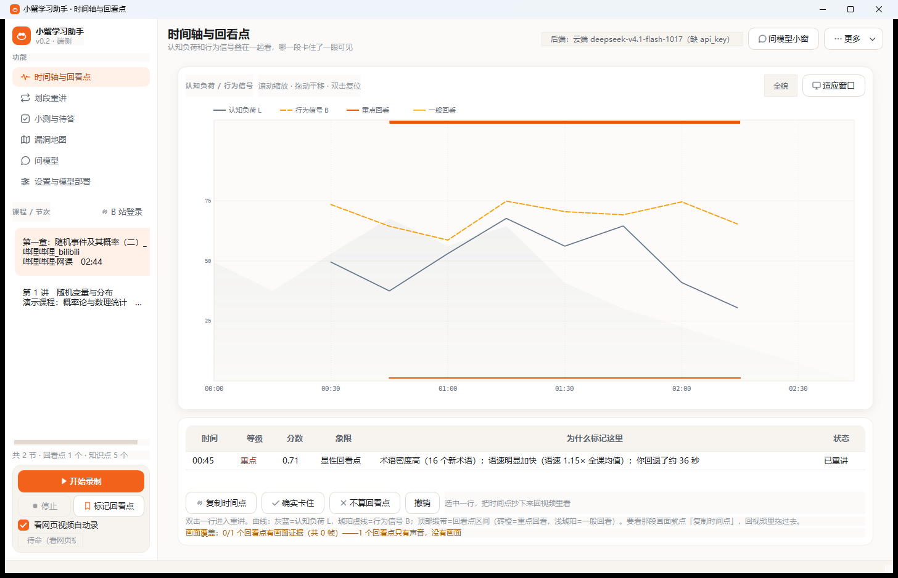

## 1. 双击启动

```
启动助手.bat          # 或：.venv\Scripts\python.exe run_app.py
```

首次打开是空的。想先看效果，点顶部「生成演示会话」；要真正跑一次自己的课，见下面的录制流程。

## 2. 看浏览器中的网课

1. 先确认录音设备：设置页顶部「录音设备」默认是「默认输出设备的环回（推荐）」，点「试读 1 秒」——
   绿灯说明这个设备正在出数据，可以录。
2. 点「● 开始录制」，填课程名 → 这一节标题。
3. **去浏览器正常播放那节课**（系统回环采的是声卡输出，不碰浏览器、不装扩展、不注入任何东西）。
4. 听的过程中觉得"这里我没跟上"，点一下「标记回看点」按钮 —— 手动标记的权重高于任何自动信号。
5. 听完点「■ 停止并分析」。程序依次：转写 → 认知负荷 → 行为信号 → 融合判定 → 落库。
6. 在「时间轴与回看点」看曲线与回看点清单；双击某一行直接进「划段重讲」。

> **蓝牙耳机的坑（已实测）**：蓝牙输出在**没有声音播放时环回设备不会产出任何数据**。
> 所以「试读」在没播放时会失败、录制刚开始的前几秒也收不到音频 —— 这不是 bug。
> 开始播放后数据就有了；如果一直收不到，界面上会显示橙色「收不到音频」，去设置页换个设备再试。
> 本机 13 个环回设备里有 Voicemeeter / VB-CABLE 等虚拟设备，它们随时有数据，
> 如果你把课程音频路由到这些虚拟通道，选它们最稳。

> **程序不录屏**。采集的只有声卡输出的音频（16-bit PCM 波形），没有屏幕画面、没有截图、
> 没有键盘输入记录。如果你连音频都不想录，下面 2.5 / 2.8 有几条现成的路。

> 没有可用的转写后端时，程序会**明确报错**而不是编造文本（"允许演示转写"默认关闭）。
> 要真实转写，见第 4 节；或者干脆用下面的字幕路径。

## 2.5 不想录也行：三条零采集路径

回看点分析真正需要的是**文本 + 时间戳**，音频只是"拿到文本"的手段之一。所以：

**A. 只给字幕（最省，推荐）**
把 `.srt` / `.vtt` 准备好（学堂在线很多课带字幕），点「导入视频/音频…」选它。
不录任何音频、不需要任何模型，时间轴来自字幕自带的真实时间戳。
实测：6 段字幕 → 14 个分析窗口 → 2 个重点回看。

**B. 只给文本（讲义、笔记、逐字稿）**
同一个按钮选 `.txt` / `.md`，程序会问这一节多少分钟，然后按字数比例估算时间轴
（界面会标"时间轴为估算值"，回看点时间只能作参考）。

**C. 连字幕都没有，只有"我记得哪里没懂"**
选中会话后点「标记回看点」（没在录制时也能用），填 `12:30 梯度为零那里`。
这是零采集用户唯一的行为信号来源，程序会把它当成强证据（权重 1.0）。

> 还有一条更省的路：如果课在 B站/YouTube 上，直接用 2.8 的「从链接导入」取字幕。

> 局限说明：完全没有任何文本/音频时，内容侧特征（语速、术语密度、停顿）无从计算，
> 只能靠手动标记做行为判定。这不是实现偷懒，是没有输入就没法判断"难在哪"。

## 2.8 从链接导入（不录屏、不下载视频画面）

点顶部「从链接导入…」，贴 B站 / YouTube 等链接（也可以只贴 BV 号）。程序按代价从低到高选路：

| 情况 | 走哪条路 | 代价 |
|---|---|---|
| 视频**有字幕** | 直接取字幕 JSON → 逐句真实时间戳 | 几 KB 流量、零转写 |
| **没有字幕** | 只下音轨（`yt-dlp -f bestaudio`）→ 转写 | 45 分钟课约 30–45 MB |
| 两者都不行 | 明确报错并说明缺什么 | 不会静默失败 |

实测数据（本机真实拉取，不是估算）：

- 抓 B 站元信息：HTTP 200，拿到标题/时长/分P；
- 157 秒视频的**音轨 2.6 MB**，同样长度录 WAV 要 28 MB —— 小一个数量级；
- **B 站的 AI 字幕需要登录 Cookie**，未登录时接口返回 0 条字幕。
  所以设置页有一个 `SESSDATA` 输入框（浏览器登录后从 Cookie 里复制，只存本机配置文件）。

> 没有设置 Cookie 时，程序会明确告诉你"未拿到字幕，需登录"，然后建议走音频转写，
> 而不是假装成功。**音频转写前会先检查转写后端是否可用**，不可用就直接报错，
> 不会让你等 30 MB 下完才发现没法转。

## 2.9 补看回看点画面（不下载视频）

链接导入的 B站会话，工具栏有「补看回看点画面」：对每个回看点，取**那一刻的视频画面**交给视觉模型，
看当时屏幕上写了什么（板书/公式/PPT），结果作为屏幕证据入库并重算。

画面来自 **B 站故事板接口**（`/x/player/videoshot`），一次请求拿一整张雪碧图 + 每帧时间点，
裁出需要的那一格。实测数据：

- 157 秒视频：1 张 317 KB 的雪碧图，含 32 帧，单格 480×270；
- 裁出来的单帧 PNG 约 72–106 KB；
- **不需要登录**，也不需要下载视频、不需要 ffmpeg。

> 为什么不用「下载视频 + ffmpeg 抽帧」：那套更准（2 fps、可去重、可九宫格），但要装 ffmpeg、
> 下载整段视频、跑解码。故事板 5 秒一帧对"看这一页是不是板书"已经够用，**代价从几十 MB 降到几十 KB**。
> 要读画面上的小字，故事板分辨率不够 —— 这是明确的能力边界，不是 bug。

> 附带发现：故事板帧里**连烧录字幕都在**（我实测的那一帧就带着底部字幕）。
> 所以对"没有软字幕、只有硬字幕"的视频，补看画面也能间接拿到文字。

## 3. 界面四个页签 = 方案四个功能

| 页签 | 对应 | 内容 |
|---|---|---|
| 时间轴与回看点 | F1 回看点识别 | 青色=认知负荷 L，橙色虚线=行为信号 B，红/橙区间=回看点；下表给时间、等级、分数、象限、**为什么标记这里** |
| 划段重讲 | F2 | 五种降维策略（换类比/补前置/数值化/反向验证/分层复述），自动推荐 + 可手选 |
| 漏洞地图 | F4 | 回看点清单、时间分布、跨节关联、按依赖排的复习顺序、结构性根因 |
| 问模型 | 3.3 延伸 | 和模型对话：可以连带本节的回看点和原文一起问；左边导入自己的资料当解释依据，回答会标注出处 |
| 设置与模型部署 | 4.6 接入层 | 云端/本地一键切换、能力探测、降级提示；七个本地模型的**检测 + 一键部署脚本** |

## 2.6 屏幕里的内容（板书、幻灯片、屏幕笔记）

音频是"老师说了什么"，屏幕是"屏幕上写了什么"。这块**不需要你操作**：
在设置页勾上「录制中自动抓取屏幕并识别」，之后由算法自己决定什么时候抓。

判断依据只有三个可解释的量，没有玄学：

1. **画面变化率**：把屏幕缩到 64×36 灰度逐像素比，变化 <12% 就不抓（这一步滤掉绝大多数帧）；
2. **冷却时间**：距上次抓取不足 30 秒不抓，避免同一页反复调用模型；
3. **每小时配额**：最多 40 帧，防止长课把 token 烧光。

抓完还有一道内容闸门：视觉模型说画面里没有课程文字（空文本）就丢弃，不入库。
状态栏会实时显示"已抓 N 帧／跳过 M 次（原因）"，做过什么、没做什么都摆出来。

**默认关闭**，因为屏幕内容涉及隐私。开启后只在录制期间工作，不录制时完全不抓。

> 识别结果会先落在库里，进「问模型」页可以看到程序抓到了什么、时间点在几秒。
> 模型认错字的情况，可以直接在对话里纠正它，或者手动补一条（见 2.5 的 C）。

## 2.7 导入你自己的知识库

除了课程本身，你还可以把需要的资料喂给它：教材章节、论文、讲义、代码、别人的笔记。

「问模型」页左边点「导入资料…」，支持 `txt / md / srt / vtt / docx`（PDF 需装 `pypdf`）。
导入后会自动切块（约 600 字一块，块间留 60 字重叠），提问时按 BM25 检索最相关的几段，
**把原文片段和文件名一起拼进提示词**，回答里也会列出"依据：《某文件》第 N 段"。

几个明确的设计取舍：

- **不用向量库**：端侧装 embedding 模型 + 建索引成本高，而你的资料通常只有几 MB；
  中文按"字二元组 + 英文词"做 BM25，对术语/公式/专有名词够用，且**完全离线，不要 API**。
- **检索是字面匹配**：你换一种说法可能搜不到。所以检索不到时会自动把本节回看点的术语
  并进查询再搜一次——这个兜底是显式的，不是假装语义检索。
- **资料分"本课"和"全局"**：导入时若已选中某个会话，就归到这⻔课；否则全局可见。

## 4. 接真实模型（两种都走同一套 OpenAI 兼容协议）

**A. 云端**（普通电脑推荐）：设置页「后端=云端 API」→ 选预设（百炼/OpenAI/自建）→ 填 `api_key` → 「探测能力」→「保存设置」。

> 配置写在 `data/config.json`。也可以不写盘：设 `DSHK_LLM_BASE_URL` / `DSHK_LLM_API_KEY` / `DSHK_LLM_MODEL`
> 环境变量即可（机器上已有的 `QW_API_KEY` 等供应商变量也会被自动捡起来，不用再粘一次）。

> **实测边界：不是所有 OpenAI 兼容端点都有语音转写**。本机配的阿里云 MaaS 端点
> `/audio/transcriptions` 返回 **404**（同一把 key 在 DashScope 上也是 404）——
> 这把 key 只能做**文本 + 看图**，录音转写要另找后端：本地 faster-whisper（离线免费），
> 或去百炼控制台开通语音识别。程序不会为此假装成功：没有转写后端时会直接报
> “没有可用的转写后端”，而不是给一段假文本。

> **推理模型的坑（已修）**：`deepseek-v4.1-flash-1017` 这类模型先输出 `reasoning_content`。
> 早先探测用 `max_tokens=8`，token 全被推理吃掉、正文为空 → 被误判成“对话失败”。
> 现在探测给 64 token，且只把 `content` 当答案；正文空但只有推理内容时会明确报
> “输出被截断，把 max_tokens 调大”，不会返回空答案。

**B. 本地/N1X**：设置页「检测本机模型与算力」会报告 GPU/内存/容量建议和七个模型的状态；
「生成部署脚本」先让你审阅脚本，「执行部署并启动」才下载并拉起服务（走 ModelScope）。
服务起来后把 `base_url` 改成 `http://127.0.0.1:<端口>/v1`。

转写后端另有三种：OpenAI 兼容转写服务、本地 faster-whisper（可选安装）、**同名侧车字幕**
（把 `.srt` 放在音频旁边，零模型也能拿到真实文本 —— 最省事的真实转写路径）。

### 3.5 「回退」和「暂停」是怎么知道的（不录屏、不装插件）

这两类行为全部从**声音本身**判断，程序不读浏览器、不读窗口、不抓屏：

| 行为 | 判据 | 参数 |
|---|---|---|
| 回退重听 `seek_back` | 同一段声音又出现一次：1 秒帧取 12 个频带的对数能量做指纹，与 `[now-300s, now-12s]` 内某帧余弦相似度 ≥0.985 且连续 2 帧命中；回退距离 ≥10 秒记 `seek_back`（带 `distance_s`），更短的记 `replay` | 冷却 20 秒，避免一句话反复播被刷成几十条 |
| 暂停 / 离开 `pause` | 播放器停住时，WASAPI 环回**仍在出数据但全是 0**（数字静音）≥3 秒 | 短于 3 秒当换气忽略；≥20 秒升级成 `overstay` |
| 设备整个不出数据 | 蓝牙/HDMI 暂停后可能一个字节都不给，采样数停止增长 ≥3 秒同样判暂停 | 由 `idle_seconds` 兜住 |

在线录制时这两条实时在跑；**导入的音频和上次没跑到的会话，在「重新分析」时会补算一遍**（只算一次，结果入库为 `source=audio_fp` / `audio_pause`）。45 分钟音频约 2–4 秒。

做不到的：`blur_pause`（窗口失焦）和 `external_search`（切去搜索）需要操作系统级窗口信息，光靠声音判断不了，所以这两类事件**没有产出者**——打分表里留着，但界面不会假装有。

### 3.6 回看点会不会「熄灭」：知识点掌握度

回看点只说明「这里难」，不说明「你补上了没」。两者必须分开，否则漏洞地图只增不减。

每个回看点会挂上 1–3 个知识点（从回看点原文里抽可信术语），知识点带一个 0–100% 的**掌握度**：

| 你的动作 | 记成 | 效果 |
|---|---|---|
| 这个讲明白了（记为有用） | 一次「对」 | 掌握度上升 |
| 这段我本来就会（排除） | 定性通过 | 直接记 100%，不参与加权 |
| 漏洞地图里点「我会了 / 还不会」 | 一次自测对 / 错 | 立刻重算 |

算法（照 HKUDS/DeepTutor 的 `compute_mastery` 改写，40 行）：

```
掌握度 = Σ(权重 × 这次对不对) / Σ权重     权重 = 0.5, 0.7, 0.85, 0.95, 1.0（越近越重）
低置信封顶：只答对 1 次最多 50%，2 次最多 80%
门槛：90% 以上才算「已补上」
```

- **近因加权**：早期答错、后来答对，不会被历史拖死；最近一次答错会把掌握度明显打下来。
- **低置信封顶**：答对一次不算会，防「蒙对」——这是最小代价的防作弊。
- **回看点熄灭条件**：挂在它上面的知识点**全部**过门槛。没识别出术语的回看点一律不算解决（宁可留着，不假装解决了）。
- 已过门槛的知识点会从「结构性根因」里退场。

（知识点从哪来、门槛怎么锁、先补哪个，见 3.14–3.16。）

### 3.7 知识库引用带页码

导入资料时会按**原始结构**切块，每块记住自己从哪来的：

| 格式 | 定位 | 引用长这样 |
|---|---|---|
| PDF | 逐页抽取 | 《笔记》p.12 |
| PPTX | 一张幻灯片一条 | 《课件》幻灯片 7 |
| DOCX | 按标题样式分小节 | 《讲义》·第三章 |
| MD / TXT | 按 markdown 标题分小节 | 《笔记》·3.2 期望 |
| SRT / VTT | 按字幕条目切 | 《录播字幕》01:12 |

关键约束：**一个块绝不跨页**。跨页的块回答不了「这句话在第几页」，引用就退化成装饰。

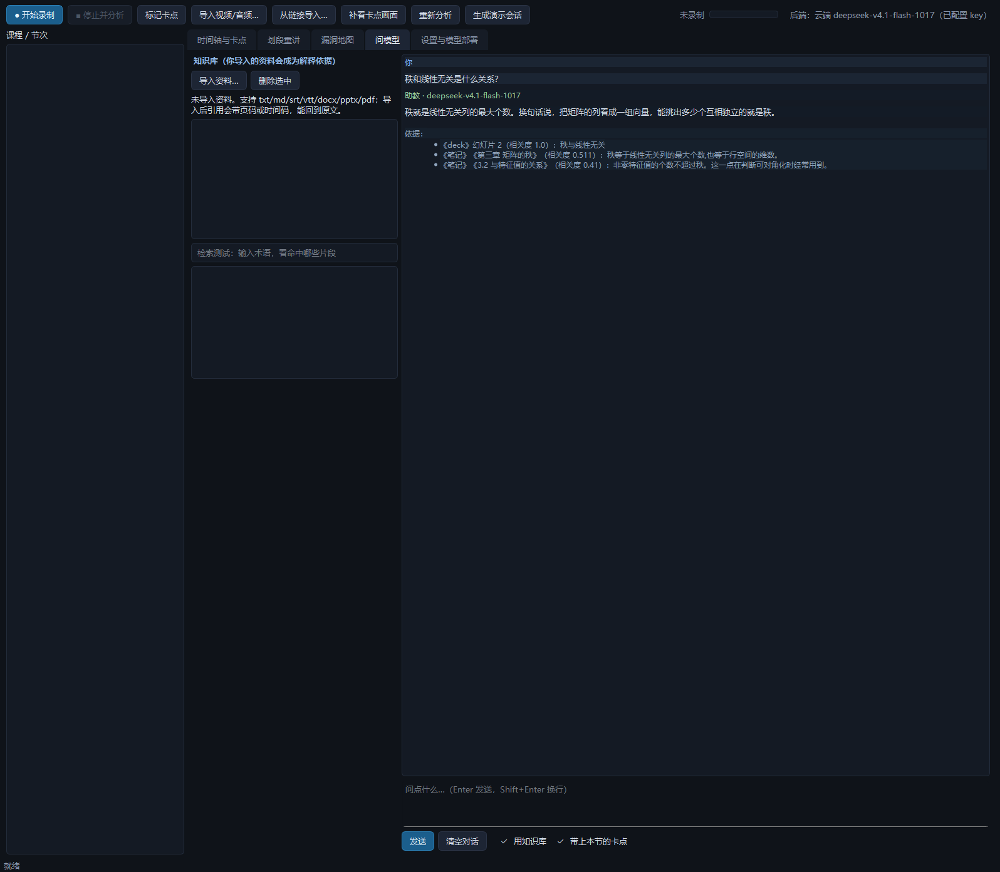

### 3.8 小测：让掌握度有真证据

上一版掌握度只有一个入口——你自己点「这个讲明白了」。那是自评，点三次就 100%，
本质是心情记录。现在补上实测：**每个回看点可以出 3 道 4 选 1 的题**。

出题的三条硬规矩（都来自「不许拿噪声当证据」）：

| 规矩 | 为什么 |
|---|---|
| 题只从**这一段的原文**出 | 题干跑偏比题目少更糟 |
| 每题必须带 `evidence`（支持答案的原句） | 编的题找不到出处 |
| `evidence` 必须能在本节原文里**查到** | 查不到 → 这道题**当场作废**，不写掌握度 |

作废的题不会消失，它留在页面上并标黄：**让人看见"模型编了一道题"**，比悄悄丢掉更诚实。

判分是确定性的（4 选 1 对就是对照就是错），不经过模型，所以不会漂移。
答对答错都会写进 `kp_attempts(source='quiz')`，掌握度立即重算。

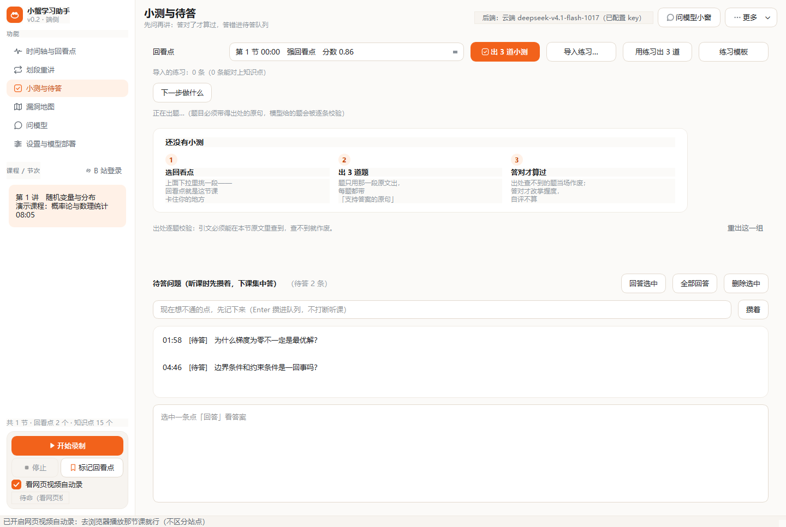

### 3.9 待答问题队列：听课攒、课下答

听课最忌讳被打断。想不通的点按 Enter 攒进队列（带时间戳和当时那句原文），
下课点「全部回答」，软件用这一节的回看点上下文 + 你的知识库逐条答完。

这一条对应方案里的 ADR-004「静默运行、课后交付」：**软件不该在你听课的时候要求你作决定。**

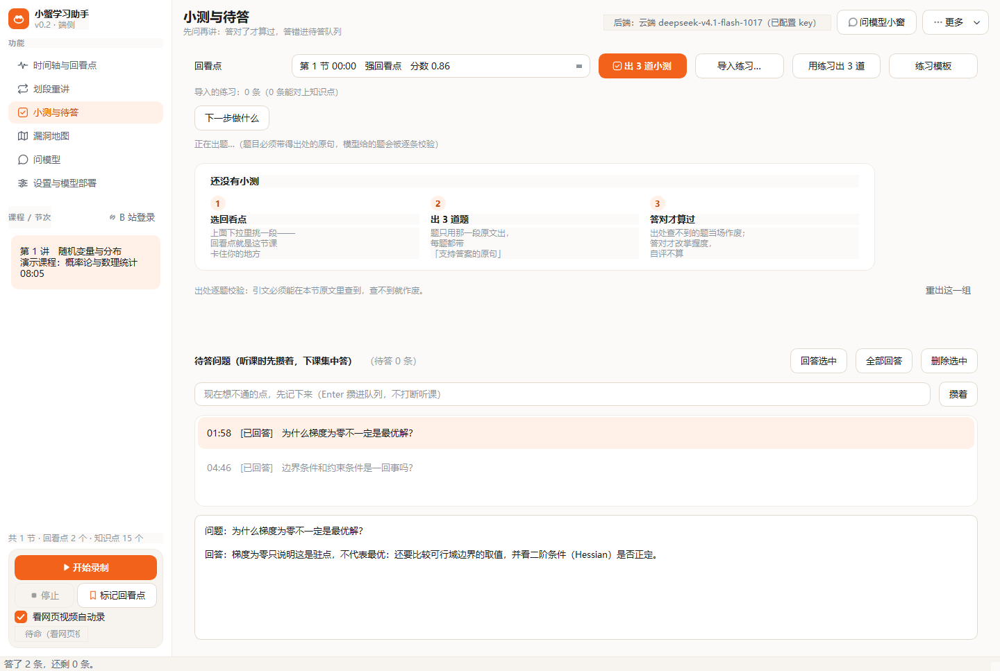

### 3.10 覆盖度：不许把「抽到了一帧」说成「全覆盖」

「补看回看点画面」只对少数回看点抓了帧。界面现在直接写清楚：

> 画面覆盖：1/4 个回看点有画面证据（共 1 帧）——3 个回看点只有声音，没有画面

以前不写这句，用户会以为那几段本来就没画面。**说清楚缺什么，比多抓十倍帧更有用。**

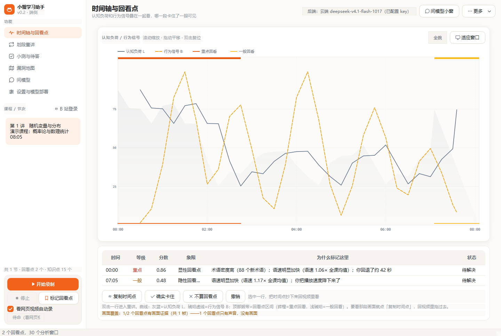

### 3.11 导出笔记：把一节装订成一份 markdown

工具栏「导出笔记」把这一节的回看点、掌握度、屏幕笔记、累积的问题与回答、结构性根因
装订成一份 `.md`，存到 `data/export/`。这是目前唯一能带出软件的东西。

### 3.12 检索的两条加固：改写 fail-open 与索引签名

**查询改写**：BM25 是字面匹配，「它是什么意思」「这一步为什么成立」这类指代型提问
一个字都检不到。现在的顺序是：

```
原问题检索 → 命中就用
          → 没命中 → 让模型把指代改写成一串关键词 → 再检索一次
          → 改写超时 / 报错 / 吐出垃圾 → 原样返回原问题（fail-open）
```

改写是加分项，不是正确性前提：模型慢、没配、答非所问，都不该让用户连原来的检索结果都拿不到。
界面回答时会记下真正用过的查询（`query_used`），改写过就看得出来。

**索引签名**：切块参数（600/60）和每份资料的块数会决定检索结果。改了参数却不重建，
表现是"说不上哪里不对"——典型的静默失效。现在每份资料导入时记一次指纹，
参数或被导入内容变化后，知识库面板会直接提示：

> ⚠️ 索引与当前切块参数不一致（签名 c8dda1→8c37a3），点「重建索引」

重建读不回原文件时会**明确报出来**（`1 份原文件已找不到`），而不是悄悄跳过。

### 3.13 记忆保持：掌握度会过期

「掌握度 100%」不等于「永远会」。一个月前补上的知识点，和昨天补上的，
在旧界面上长得一模一样——**这是"看起来在学、其实在漏"最常见的形态。**

现在每个知识点多记两个数：稳定度 `S`（天）和到期时间。留存用 FSRS 的曲线形状算：

```
R(t, S) = (1 + 19/81 · t/S) ^ (-0.5)
```

选这组常数的好处：**S 天时留存正好 90%**，于是 S 可以直接当"下次复习间隔"用，
不用再额外调目标留存率。答对涨 S（越容易想起来涨得越少），答错打回接近最小值但不归零。

界面上就是「记忆保持」这一列：

| 知识点 | 掌握度 | 状态 | 记忆保持 |
|---|---|---|---|
| 必要条件 | 100% | 已补上 | **33% 该复习** |
| 定义 | 50% | 在补 | 100% |

两个细节值得说：

1. **该复习的排在最前**。它掌握度还是 100%，只按掌握度排序会被压到最底下，
   等于把最该做的事藏起来。
2. **没测过的显示「—」**，不写 0%。"没验证"和"忘光了"是两件事。

「下一步做什么」按 **闸门 → 该复习 → 没过门槛 → 开新节** 的顺序挑一件事，并说明为什么是它：

> 「必要条件」留存已掉到 33%，再放下去就要重新学了 → 已选好回看点，点「出 3 道小测」

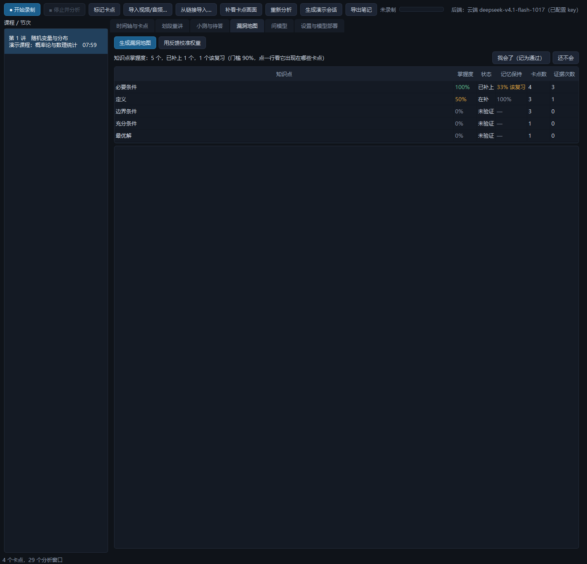

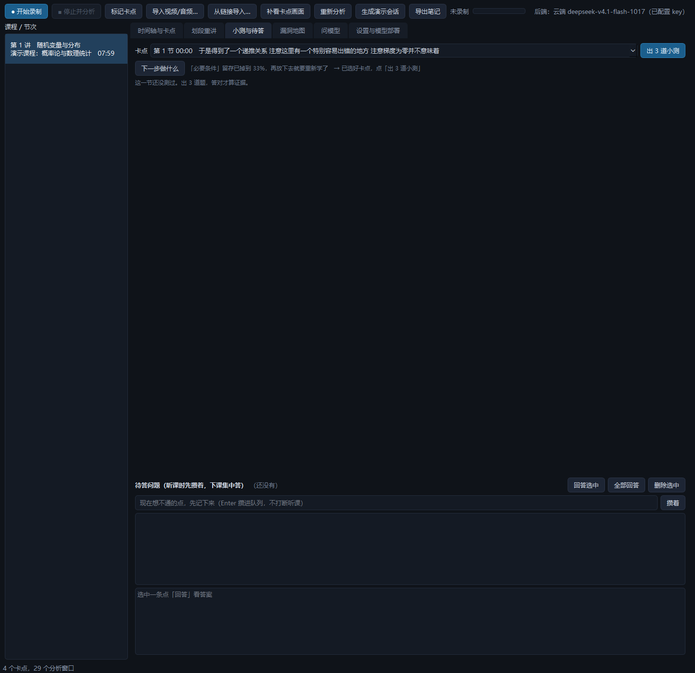

### 3.14 知识点不能是「定义」这种词

之前知识点是从术语密度那套词表里直接取的，取出来是 `定义 / 必要条件 / 边界条件 / 充分条件 / 最优解`。
问题很清楚：**这些词描述"这是哪种命题"，不描述"这一节教了什么"。**
掌握度、小测、复习全挂在知识点上，知识点是"定义"，整条链再准也没有意义——
没人会说自己"掌握了定义"。

现在术语走独立一层（`dsh_app/terms.py`），三层证据叠加才成一个术语：

1. **定义句式**：`所谓 X，是指…` / `X 是指…` / `X 定义为…` / `记作 X` / `设 X =`。
   被明确定义过的词权重最高，而且单字也放行——「所谓鞅，是指…」里的「鞅」就是术语。
2. **术语性后缀**：定理/定律/分布/函数/矩阵/不等式/映射… 但只认**左边界干净**的：
   窗口切在字中间（`样本空间映射`、`算出来期望`、`人把条件概率和联合概率`）直接判死。
3. **学科词表**：命中数学/计算机/物理化学/经济管理的预置词表；元词（定义、定理、必要条件…）
   被单独排除，它们只用于"术语密度"点火，不再当知识点。

真实转写没有标点、满嘴口头语（「呃然后分布函数呢定义为Fx等于PX小于等于x」），
所以边界剥除要**交替做到不动为止**（先剥「呃」才露出「然后」）、公式一律判死
（`Fx等于PX小于等于x` 是定义正文不是术语）、光秃秃一个后缀（「分布」）不算术语。
同一段 ASR 文本和干净文本，现在抽出的是同一组词。

旧规则抽出来的知识点不会永远赖着：**没人验证过的删掉，有证据但已经没有回看点的退役**
（`retired=1`，记录留在库里、退出"该学什么"的计算，界面上写「N 个已退役」）。
不这么做就会出现"沉默的死锁"——「必要条件」这种词没法重讲（没有回看点）、没法出题，
却永远挡在门槛前面。演示库里现在 17 个知识点、1 个退役。

有模型时再加一层：模型提名术语，但**必须给出原文里的那句证据**，
`grounded()` 查不到就丢弃并计数；模型挂了就退回规则路径，来源写进 `knowledge_points.origin`（`llm` / `rule`）。

演示课从"合成填充文本"换成了真正的概率论内容，同一套规则现在抽出的是：

```
分布函数  参数  均值  方差  期望  条件概率  极限  样本空间
概率密度  泊松分布  联合概率  连续  随机变量
```

规则升级不需要重听音频：漏洞地图页多了「重建知识点」，
它按现存转写重算并顺手清掉"既没被验证过、也没挂上任何回看点"的旧知识点（`prune_orphan_points`）。
真实库的迁移用 `tools_migrate_demo.py --apply`（会先备份 `data/app.db`）。

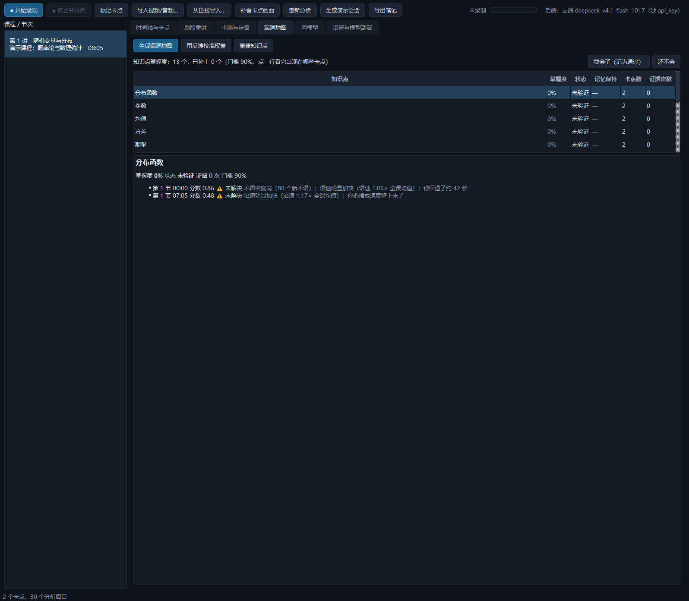

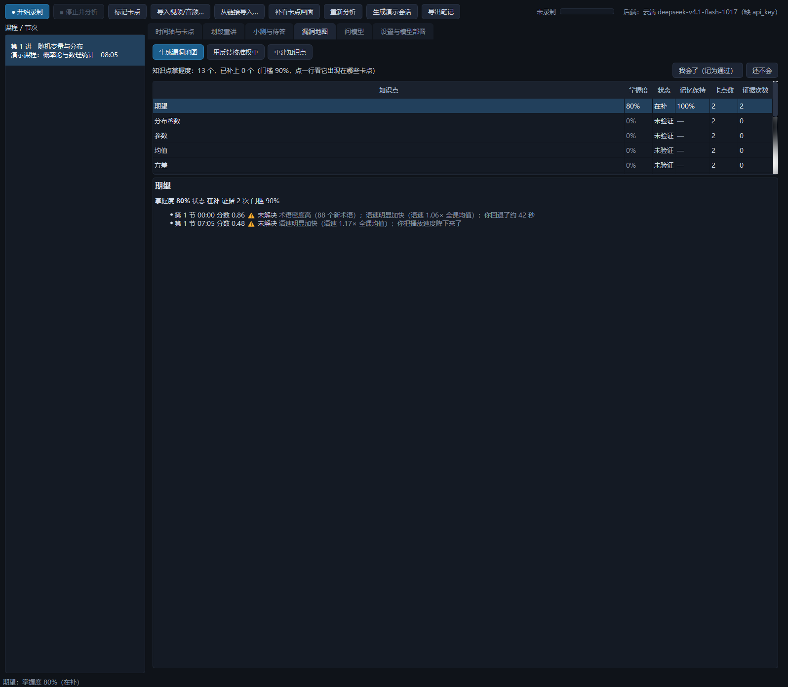

### 3.15 硬门槛：没过 90% 就不许往下走

「门槛」以前只是个显示出来的数字：掌握度 30% 的知识点，界面照样会让你"去做题"或"开新节"。
现在它是**闸门**，顺序是硬的：

| 状态 | 下一步 | 为什么 |
|---|---|---|
| 没过门槛、还没重讲 | **重讲**（动作是 replay） | 讲都没讲明白，做题只是猜 |
| 没过门槛、已经重讲过 | 出 3 道小测 | 重讲本身不算证据 |
| 过了门槛、留存掉到 90% 以下 | 复习 | 该复习的排最前 |
| 都干净 | 开新的一节 | —— |

重讲用哪个策略也**不交给模型挑**：模型偏爱挑听起来高级的讲法，而眼下缺的往往是最基础那层。
规则是（`Engine.forced_strategy`）：

- 没有任何证据 → `补前置`（讲清它从哪儿来、依赖什么）
- 掌握度不到门槛的一半 → `类比`（先把基本形状立住）
- 只差一点 → `分层复述`（补齐细节）
- 已过门槛 → `具体数字走一遍`

状态是靠回看点的 `status` 走的：重讲一次（哪怕是降级提纲）记 `explained`，
下一步立刻变成"出小测验证"——不给"重讲卡死出不去"留口子。降级会单独记 `replay_degraded`，
不会把降级当成真讲过。

### 3.16 知识图谱的边喂学习顺序

知识点之间的边原来只用来画图。现在它决定**先补哪个**：

- 边的方向按"谁先出现"定：`first_seen_t` 更早、且掌握度还在门槛之下的，才算后者的前置；
  严格先后（不是 `<=`），否则两个知识点会互为前置，顺序就没意义了。
- 排序主键是掌握度（该补的在前），然后做一遍插入式修正：前置必须排在依赖它的知识点之前。
- 每个知识点因此多两个字段：`prereqs`（前置是谁）和 `blocked_by`（前置里还没补上的）。
- 「下一步」挑的是**没有被未补前置挡住的第一个**，所以会先让你补「随机变量」，
  而不是直接跳到「方差」——后者依赖的「期望」还没立住。

实测顺序（演示课）：

```
随机变量 → 样本空间 → 分布函数 → 连续 / 期望 → 均值 / 方差 → 极限…
```

> 「随机变量」还没测过，没过 90% 的门槛：先重讲这段，不要跳到做题或新内容；它不依赖别的知识点，从这里开始最省力

### 3.17 练习导入：老师发的 xlsx / csv 直接能判分

模型出的题受幻觉限制，所以每题都要回查原文；但老师发的练习册本来就是权威答案，
一份 40 题的练习比模型现编的 3 道题有用得多。两条路都留着，**来源必须分开标**：

- 模型题：`source='llm'`，文案必须能在本节原文查到，查不到作废、不写掌握度。
- 导入题：`source='import'`，答案以文件为准（不做原文回查），判分规则完全相同。

小测页多了三个按钮：「导入练习…」「用练习出 3 道」「练习模板」。
模板列是 `知识点 / 题干 / 选项A-D / 答案 / 解析`，答案写 `A-D`、`1-4` 或选项原文都认；
表头认中文也认英文（`term / question / option1 / answer / explanation`），
CSV 自动试 utf-8 / gb18030 / utf-16，分隔符按逗号/制表/分号里出现最多的那个。

**认不出的东西一定要说出来**：答案对不上选项、选项不足两个、知识点名没对上，
都会带行号报出来，不会出现"导入成功 0 条"这种静默失败。
知识点名能对上就挂到那个知识点上，答对答错照常写掌握度；对不上的只存名字，并在界面上写清楚是哪几个。

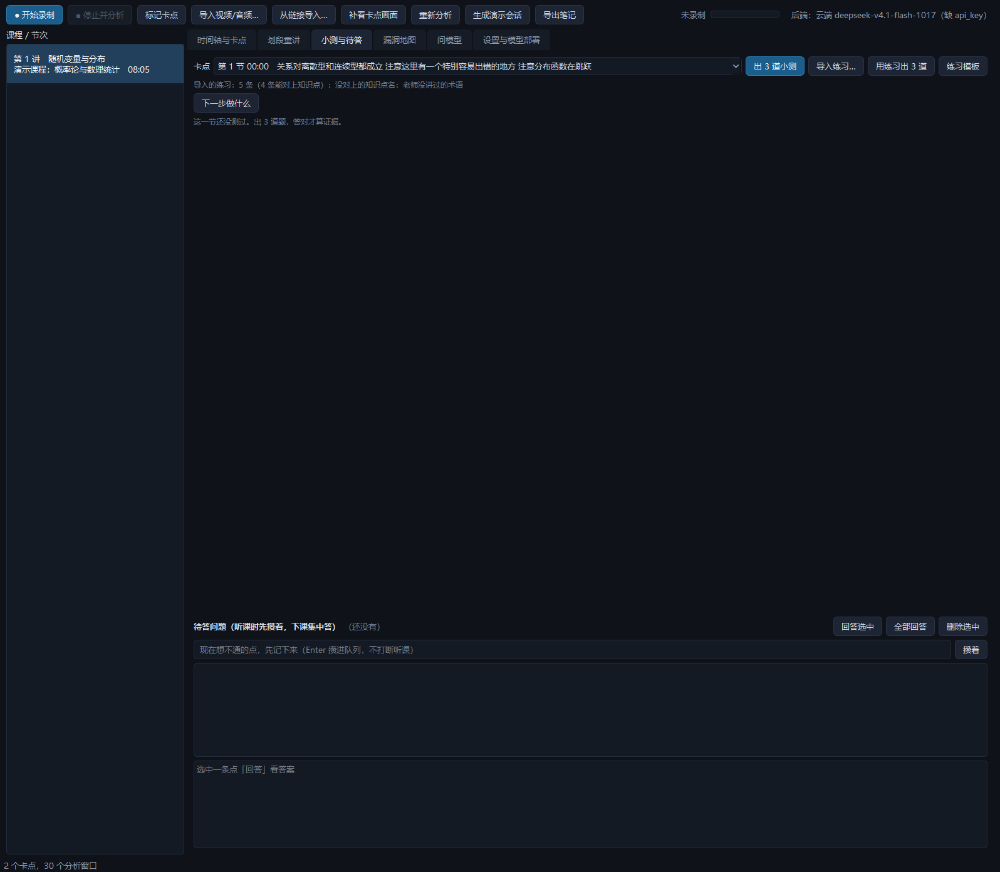

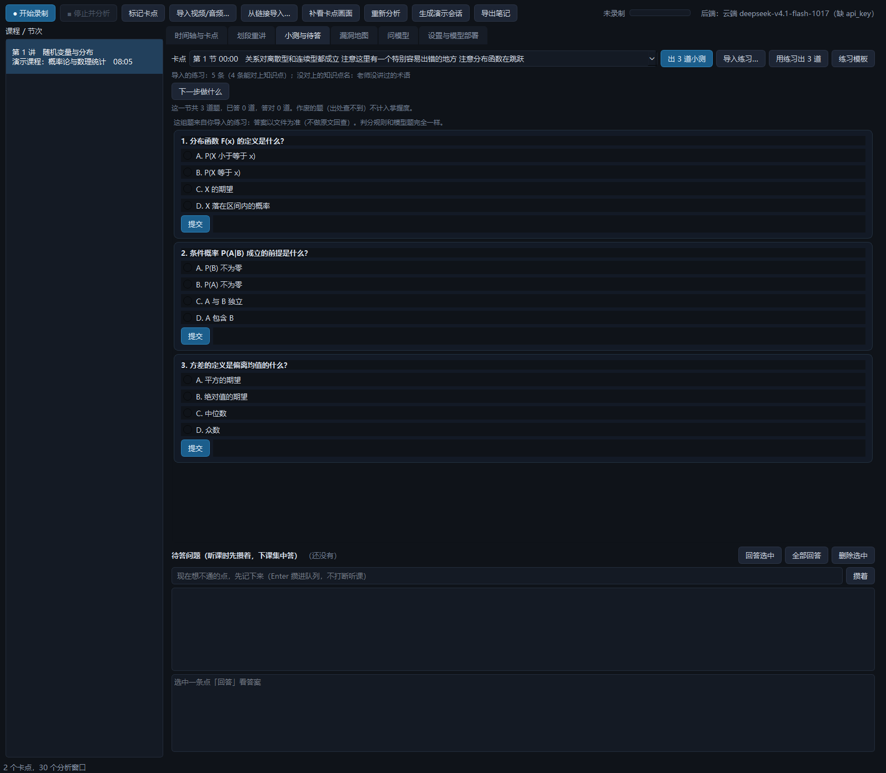

### 3.18 看网页视频自动抓：不装插件，任何站点都覆盖

工具条上多了个勾选框「看网页视频自动录」。勾上之后：**浏览器一放视频就开始录，安静下来就自动停并分析**，
中途不用点任何按钮。

为什么不做浏览器插件（虽然 B 站那种插件很好用）：

| 方案 | 覆盖 | 代价 |
|---|---|---|
| 浏览器插件 | 只覆盖"愿意做插件/有字幕接口"的站点 | 用户要装、要维护、站点改版就失效 |
| 站点 API / 字幕抓取 | 只有 B 站、YouTube 这类 | 学校自建平台、腾讯会议回放、各种网课平台都没有 |
| **系统回环 + 音频会话** | **所有浏览器、所有站点** | 只能拿到声音（画面另算，见 3.10） |

判据只有一条：**浏览器进程有没有在放声音**。用 Windows 音频会话（`IAudioSessionManager2`）枚举，
`chrome / msedge / firefox / brave / qqbrowser / 360se / …` 这些进程的会话变成 `Active` 就算在放。
这是系统级的，所以不区分网站——学堂在线、B 站、学校自建平台、YouTube 全都一样。

两个"宁可漏、不可误"的取舍：

1. **只认浏览器进程**。音乐播放器、会议软件、游戏在放声音不会触发录制。
2. **起停都要迟一步**。连续出声 2.5 秒才开始（躲开点开就关的广告页）；
   安静 25 秒才停（课中间的暂停、缓冲不该把一节课切成两段）。

还有一条靠电平：音频会话会"赖着 Active"（浏览器把流开着但页面静音/暂停），
所以停录要**会话不活跃 且 回环里真的没声音了**两个条件同时满足，否则容易录三小时空气。

自动录的会话标成 `source='webvideo'`，课程按**站点**归（`哔哩哔哩·网课`、`学堂在线·网课`），
节名用页面标题（去掉浏览器加的后缀）。按站点归而不是按标题归，是因为标题每集都不同，
按标题一学期会散成几十门"课"。

自检：`run_app.py --probe-webvideo` 会连看三次音频会话并回答"这台机器现在能不能自动抓"。

**护栏（真机试出来的）**：浏览器弹一个提示音、广告前奏、视频预览，都会让回环里有声音，
于是自动抓取会起录几秒、停录、再送进转写——然后弹一个"转写失败"的报错框。
这条链路上有两个错，都修了：

1. **短抓取直接丢掉**。`capture.web_min_keep_s`（默认 8 秒）以下的自动抓取整个撤掉：
   会话、事件、音频一起删，状态栏只说一句"只响了 N 秒，当提示音忽略了"。
   真人讲课时 8 秒连一句话都说不完整，留着只有坏处。
2. **自动抓取的分析失败不弹模态框**。用户此刻正在看视频，屏幕中央盖一个"分析失败"
   是最讨人厌的打断。自动起头的失败只在状态栏说一句、会话行标成 `error`；
   想看再右键「重新转写这一节」（音频还在就能重跑）。手动点分析的失败照旧弹框报清楚。

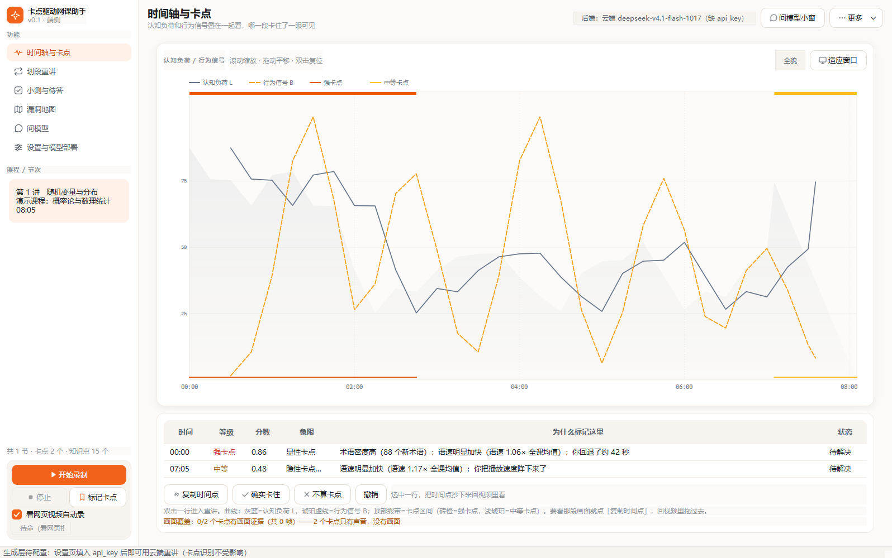

### 3.19 界面：橙白主题（浅色、圆润、均匀）

界面从深色换成浅色：白纸底 + 一点橙。橙只用在两处——**主操作**（开始录制、生成重讲、
出小测、发送）和**当前状态**（选中的页签、选中的行、回看点缎带）；其余靠留白、字号和
一层很浅的投影分层，不用满屏色块堆层次。

颜色、圆角、间距全部收在 `dsh_app/ui/theme.py` 一个文件里（控件里写 `theme.ACCENT`、
`theme.R_CARD`、`theme.GAP_M`，不再写色值和魔法数字），所以以后调色只改那一处。
测试盯着三件事：UI 代码里出现裸色值就失败；圆角必须按 `控件 10 < 卡片 14 < 胶囊 999`
排序；间距必须用同一套 4/8/12/16/22 的节奏。

布局为什么"均匀"了：

- **顶部不再堆按钮**。上一版十个按钮挤在一条工具栏里，屏幕一窄就折成两行，还和页签
  抢注意力。现在按"在哪用"分三层：导航在左栏、录制三件套在左栏底部、低频操作收进
  页头「更多」菜单。页头只剩标题、一句话说明、后端状态和「问模型小窗」。
- **只有一处导航**。页签栏用 `tabBar().hide()` 藏起来，左栏竖排六项带图标；页签索引
  仍是唯一的真相，导航和页头都跟着它走（测试 `test_nav_and_tabs_stay_in_sync` 盯着）。
  想一想"代码里 setCurrentIndex(1) 之后导航跟不跟"，就知道为什么两边都要连。
- 六个页签走同一个版心 `_page()`（边距 16/12、间距 12），不再每页各写一套数字。
- 一个界面只有一种"框"：图表、回看点表、知识点表、知识库、侧栏都装进 `QFrame#card`
  卡片，表格自身 `NoFrame + ShowGrid(False)`，靠卡片包出圆角；卡片内部列表再加一层
  边框会变成"双框"，所以知识库列表用 `QListWidget#plain` 无框样式。
- 回看点表、知识点表按行数定高，卡片贴合内容，多余高度全给图表——原来表下面一大片白。
- 小测页的空状态贴着操作行往下排（不再在页面中间吊着），并改成三步引导
  （选回看点 → 出 3 道题 → 答对才算过）。
- 漏洞地图的详情区加了「详情 / 报告」标题条：它很高，不写标题就像页面塌了一块。
- 时间轴加了左侧 25/50/75 百分比刻度：图很高的时候，光有曲线只能看出起伏、读不出多难。

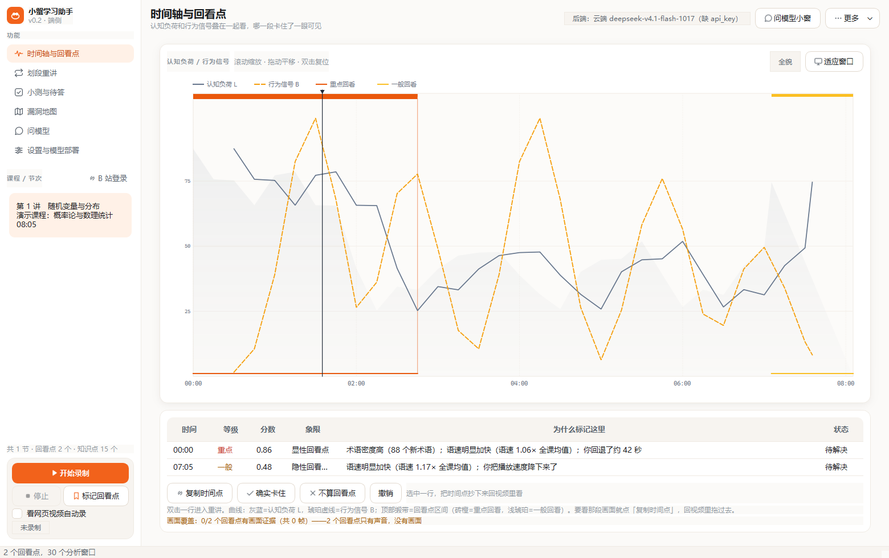

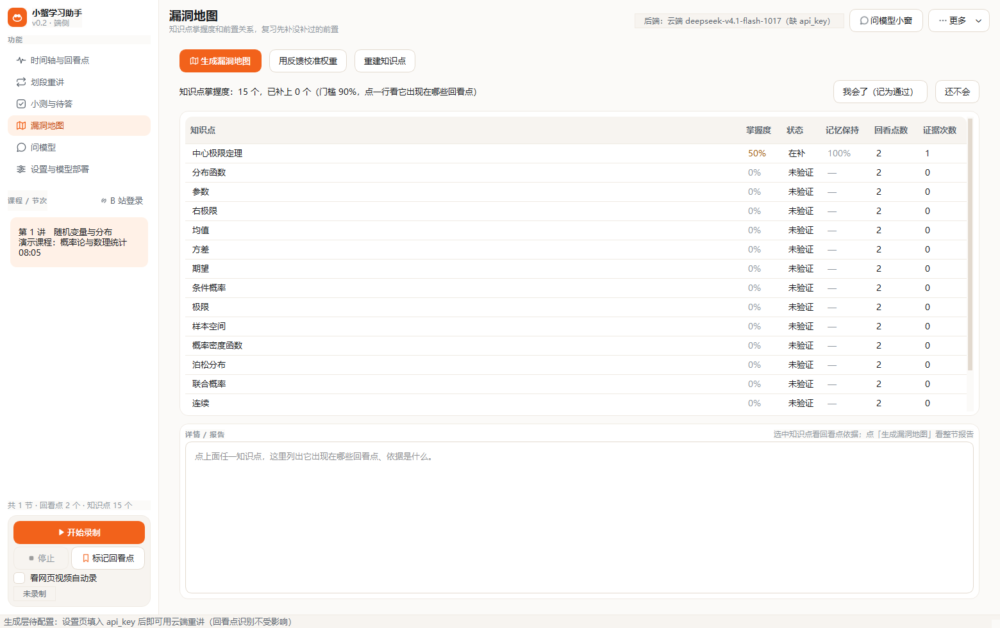

| 页签 | 图 |
|---|---|
| 时间轴与回看点 | [28-theme-timeline.png](docs/screenshots/28-theme-timeline.png) |
| 划段重讲 | [29-theme-reword.png](docs/screenshots/29-theme-reword.png) |
| 小测与待答 | [30-theme-quiz.png](docs/screenshots/30-theme-quiz.png) |
| 漏洞地图 | [31-theme-map.png](docs/screenshots/31-theme-map.png) |
| 问模型 | [32-theme-chat.png](docs/screenshots/32-theme-chat.png) |
| 设置与模型部署 | [33-theme-settings.png](docs/screenshots/33-theme-settings.png) |

换肤时踩到的坑（都已写进代码注释，别再踩）：

1. **Qt 的富文本不认 `background` / `border-left`**。对话气泡原来靠 div 上色，
   换到浅色主题后整块变白——文字浮在白纸上。实测只有 `<table bgcolor=...>` 真的涂色，
   所以气泡改成"左边 4px 色条 + 右边底色"的表格。探针脚本的输出留在
   `data/probe/bubble_test.png`，测试 `test_bubbles_use_tables_because_qt_ignores_div_background`
   盯着这条约束。
2. **QSS 的 `font-family` 只认第一个能用的**，写成 `"a","b",sans-serif` 在离屏渲染下会挑到
   没有中文字形的字体，整屏豆腐块。字体改成 `theme.apply_font(app)` 用
   `QFont.setFamilies()` 设，QSS 只管颜色和尺寸。
3. **回看点不能整列刷色**。原先把回看点区间整列铺半透明色，白底上像被荧光笔涂过，
   三四个回看点就把曲线糊掉。现在顶部缎带（选中时加高 + 两侧细线）+ 底部短横标记，
   "哪几段卡住了"照样一眼看到，曲线也不会被盖住。
4. **只设 `setMaximumHeight` 等于没设**。布局会按 `sizeHint` 给高度，表格照样只露五六行；
   要上下都钉住（`setMinimumHeight` 一起设），超出上限让它自己滚。
5. **两个子项都封了上限时，多出来的空间会被摊成"上下各一段大空隙"**。漏洞地图那张表和
   详情框都限高之后，中间就鼓出两块空白——留一个可伸缩（只给最小值）就正常了。

### 3.19b 图标：27 个手画 SVG，不下载图标包

界面上的图标都在 `dsh_app/ui/icons.py` 里：24×24 网格、1.7 线宽、圆头圆角，按 `QIcon`
现渲（含 2× 位图给高分屏）。不引第三方图标包有三个实际理由：颜色得跟着主题走
（侧栏灰 / 选中橙 / 主按钮白）、下载物不许落 C 盘、还有授权问题。

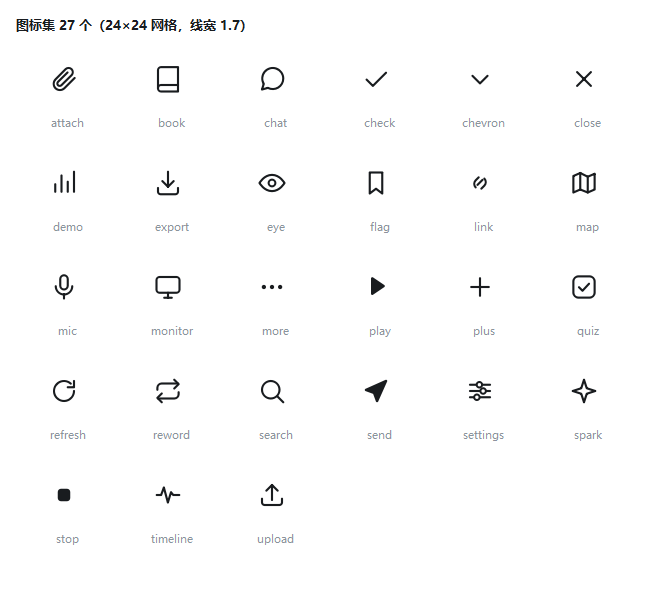

第一版用 `QPainterPath` 一笔一笔画，弧线全歪——多个子路径没 `moveTo` 就从原点拉线，
渲染出来是一堆"星芒"。改成手写 SVG 路径（`M/L/C`）后既准又好读。

两个踩过的细节：

- **"标记回看点"用书签不用旗子**。旗子无论怎么画，缩到 15px 都会被读成字母 `P`；
  书签本身就是"在这一刻做个记号"，和这个动作是同一个隐喻。
- **图标颜色要显式传**。`danger` 按钮是白底，`TEXT_ON_ACCENT` 的白图标压上去等于没有，
  停止按钮的图标必须是 `theme.BAD`。

自检：`python tools_shot_icons.py` 重排一张对照图（`docs/screenshots/35-icons.png`），
整套图形是不是一个体系，看这张图最快。

### 3.20 边看边问：问模型小窗（拖文件 / 粘截图）

听课是"一边放视频一边冒出问题"，主窗口一最大化就把视频盖住了。所以「问模型」多了一个
**独立小窗**（工具条「问模型小窗」或问模型页「弹成小窗」）：默认置顶、能拖到屏幕边上、
问完随手关掉。位置和大小记在 `data/ui_state.json`，下次开在原来的地方。

三种输入，都是为了让"看到什么就问什么"不用离开视频：

| 怎么给 | 结果 |
|---|---|
| 截图后 `Ctrl+V` | 剪贴板里的图变成附件（缩略图在输入框上方，可 ✕ 删） |
| 把文件拖进窗口 | 图片走视觉模型；pdf/docx/pptx/txt/md/srt/vtt/csv 抽成文本当资料 |
| 只发附件不打字 | 允许。等于"看看这个"，会自动补一句默认提问 |

实现上有三条硬规矩：

1. **图片必须真的发成 `image_url` 段**。如果把图"描述"成文本塞进提示词，模型只是在猜
   图里写了什么，界面上还看不出来——所以 `chat.build_messages` 在有图时改用 OpenAI 兼容
   的多段 content，测试 `test_images_go_as_image_url_parts` 盯着这条；一次最多 4 张
   （再多模型也看不过来，还容易超时）。
2. **不支持的文件要当场说清楚**（`.exe`/`.zip`/视频这类），不能静默丢弃——用户会以为发
   出去了。拒绝原因直接写在附件条上。
3. **附件正文标明来历**：拼进提示词时带「【用户附件《文件名》】」，和知识库检索结果分开，
   回答里就不会把"你发的讲义"说成"你导入的知识库"。

图片会先在本地压到长边 1400px 的 JPEG（`screen.encode_jpeg_bytes`）再发：原图 4 MB 直接
塞进请求，慢网下基本是超时。小窗和主窗口共用同一个消息列表，窗里问过的回到主页还能看到；
切课的时候小窗的 `session_id` 会跟着换，不会拿上一节的回看点当上下文。

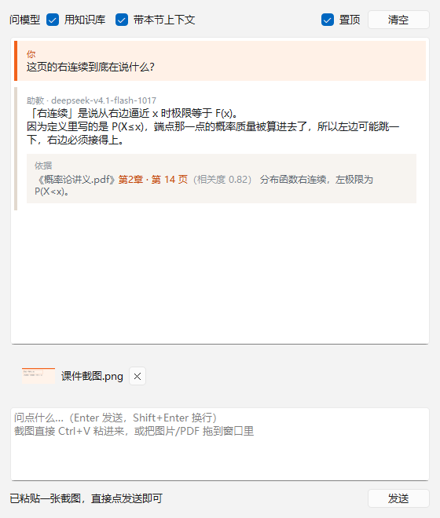

### 4.0 配模型：选服务商 → 选模型，不用背参数

设置页「生成层」现在是这样一条路：

1. **服务商**下拉：阿里云百炼 / DeepSeek / 智谱 GLM / 月之暗面 Kimi / 硅基流动 / OpenAI / Ollama 本机 / LM Studio 本机 / 自定义。
   选中它 = 自动填好接入地址 + 给出这家常见的模型候选 + 在「去哪拿 Key？」直接给入口。
2. **API Key**：只粘贴，不要求你理解它是什么。Ollama / LM Studio 这类本机端点会把这一栏自动置灰（不需要 key）。
3. **模型**下拉：先放该服务商的常见模型；点「刷新列表」或「探测能力」后，会用端点真正返回的 `/models` 覆盖，
   所以看到的一定是**这个 key 真的能用**的模型（本机实测 50 个）。也可以手动输入名字，私有模型不会被列表清掉。
4. **视觉模型**：默认勾「屏幕识别也用这个模型」；要单独指定（例如 GLM-4V、qwen-vl-max）就取消勾选再挑。

启动软件时会自动把模型列表拉一次（有 key 才拉，避免每次都撞一条 401）。地址被手改过时，
服务商会自动落到「自定义」——不会出现"显示阿里云、实际连的是别的地址"这种误导。

### 4.1 本地转写（Whisper）：软件里就能装

设置页有「**本地转写（Whisper）**」一栏，四个按钮：检测状态 / 安装依赖 / 下载模型 / 测试转写。
它对应三件独立的事，任何一件失败都能单独重试，并且**如实报告**：

| 步骤 | 做了什么 | 失败时会怎样 |
|---|---|---|
| 安装依赖 | `pip install faster-whisper`（阿里云镜像） | 显示 pip 原始报错尾部 |
| 下载模型 | 逐文件流式下到 `data/models/faster-whisper-<尺寸>` | 报出是哪个文件、什么错 |
| 测试转写 | 拿一段真实音频跑一遍，报段数/用时/倍速 | 报"识别不出分段"或异常原文 |

本机实测（RTX 5060 + 16 核，**纯 CPU int8**，157 秒真实中文语音）：

| 模型 | 体积 | 用时 | 倍速 | 备注 |
|---|---|---|---|---|
| small | 464 MB | 40 s | **3.9×** | 个别专有名词会听错（GitHub→"Gatehub"） |
| medium | 1.5 GB | 54 s | **2.9×** | 准确度明显更好，同一段话连"刷B站"都对 |

> 45 分钟的课：small 约 12 分钟、medium 约 16 分钟转完，都在可接受范围。

**踩到并修掉的两个坑**：

1. **medium 会把普通话转成繁体**（"這是我的第一個項目"）。用 `initial_prompt` 钉住简体书面语后恢复正常；
   同时关掉 `condition_on_previous_text`，长课不会越译越飘。
2. **GPU 不是"有卡就能用"**：ctranslate2 在 Windows 上需要 `cublas64_12.dll` / `cudnn*_9.dll`，
   而它**构造模型时不报错、第一次推理才抛** —— 早先的回落逻辑只在加载处 try，抓不到。
   现在回落覆盖到"迭代生成器"这一步，并且一旦发现缺库就在本进程内记住，不再白试。

> 想用 GPU 的话：`pip install nvidia-cublas-cu12 nvidia-cudnn-cu12`，
> 程序会自动把 `site-packages/nvidia/*/bin` 挂到 DLL 搜索路径（Windows 默认不会去那找）。

### 3.21 音频：压成 FLAC，删了也不心疼

系统回环录音是 44.1 kHz 立体声 WAV，**一节 90 分钟的课接近 0.9 GB**。而转写只要 16 kHz
单声道——多出来的都是白占空间。所以分析一结束就把 WAV 压成 **16 kHz 单声道 FLAC**
（约 95 MB，省 9 倍），压完的课**照样能重新转写、照样能重新分析**。

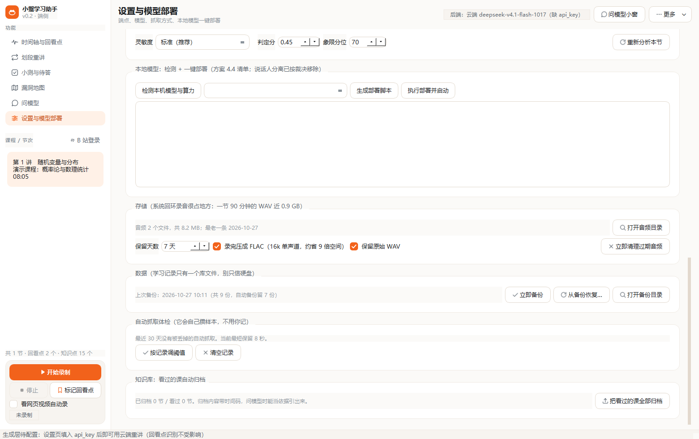

设置页「存储」这一块就是这件事的全部开关：

| 控件 | 作用 | 默认 |
|---|---|---|
| 保留天数 | 超过就从磁盘删音频（课、回看点、题目全留着） | 7 天；填 `0` = 永不清理 |
| 录完压成 FLAC | 分析完自动压 16 kHz 单声道 | 开 |
| 保留原始 WAV | 勾上就不压缩（要拿原文件喂别的工具时才勾） | 开 |

四个实现细节值得写下来，都是"不做就会悄悄坏"的那一类：

1. **读音频不能只认 WAV**。老代码里算时长、读波形、补算回溯全是 `wave.open`，转成 FLAC
   之后不报错，只是时长变 `0`、波形全零——然后回看点识别悄悄失效。现在所有读取收口到
   `dsh_app/audio_io.py`（`read_mono16k` / `duration` / `read_segment`），`capture.py` 里
   那几个老函数名保持不变，内部改调它。
2. **必须分块转码**。90 分钟 44.1 kHz 立体声读进内存转 float32 是 2 GB，压完再写出来会直接把
   内存打满。`compress_to_flac` 每 20 秒读一块、写一块；块与块之间多读 0.5 秒尾巴，
   重采样后丢掉开头那段重叠——接缝落在"上一块的内部"，不会有咔哒声。
3. **压缩失败不能挡住分析**。转码抛异常只记一条 `sessions.error`，原 WAV 原样留着。
   省空间是次要目标，"证据不丢"是主要目标。
4. **清理只删文件，不动数据库记录**。`sweep_audio` 删掉过期音频后把 `audio_path` 清空，
   转写/回看点/掌握度一条不少；要点原文时界面会明说「这节的音频已按保留策略删除」。

### 3.22 回看：只给时间点，不做内嵌播放器

第一版在这里做了「回听这段」：用 `soundfile` 读回看点前后 20 秒、`pyaudiowpatch` 写出去
（venv 里没有 `QtMultimedia`）。**这个功能后来删掉了**，理由是它解决不了真问题：

- 手里只有音频，**没有画面**。真正卡住的地方是"这一步推导怎么来的"，
  听 20 秒老师的声音完全看不出板书走到哪一行。
- 用户本来就在浏览器/播放器里看那节课，那里有画面、有进度条、有倍速。
  软件再放一遍声音，是让人在两个窗口之间对时间，比不用还麻烦。

所以现在这一排是 `复制时间点 / 确实卡住 / 不算回看点 / 撤销`（右键表格同一套动作）。
点"复制时间点"把 `mm:ss` 放进剪贴板，附带一句「回视频里拖到这一刻」；
选中一行时旁边的灰字就先写好这一刻是第几秒、是重点回看还是一般回看。用户切回原来的播放器，
把进度条拖过去就行——一秒不差，而且有画面。

**三种复制方式**，按"抄出去之后要干什么"分：

- 按钮「复制时间点」→ 剪贴板只有 `00:45`。适合切到播放器的进度条上直接敲。
- 右键「复制时间点 + 判定依据」→ `00:45　重点回看（0.71）｜术语密度高（16 个新术语）；…` 加一行原话。
  适合贴进笔记/答疑区，自带"为什么是这里"。
- 选中一行时旁边那行灰字已经写好时刻和去向：自动抓的网页视频会说
  「回哔哩哔哩·网课 的播放器拖到这一刻」，手动录的只说「回视频」。

**顺带删掉的**：`dsh_app/playback.py`、`tests/test_playback.py`、`bar_play` 进度条和
四个播放信号处理器。音频仍然保留（转写、重新分析、回溯检测都靠它），只是不再由这个软件发声。

### 3.23 回看点误判：可以不认同，但不许删数据

算法一定会误判。之前的界面只能"接受"，于是错误结论会一直挂在重讲选项和复习建议里。
现在每个回看点有三个判断：**确实卡住**（记正反馈）/ **不算回看点**（`status=dismissed`）/ **撤销**。

关键设计：**`dismissed` 不是删除**，行还在，只是：

- 回看点表里整行变灰（还看得见，方便撤销），状态列写「已忽略」；
- 不进重讲下拉、不计入覆盖率、不进复习建议（界面统一用 `_active_knots()` 过滤）；
- 留一条 `feedback(action='dismissed')` —— "算法说卡住、用户说不是"恰恰是以后调阈值最值钱的样本；
- **重新分析不会复活它**：分析前先记下被忽略的时间区间，新算出的回看点落在这些区间里就重新标回
  `dismissed`。否则每次重新分析，用户的判断都被算法覆盖一遍。

灵敏度也不再写死在代码里：设置页「回看点识别」给了三档（保守 0.55/75、标准 0.45/70、
积极 0.35/65），也可以手填「判定分」和「象限分位」。只暴露这两个阈值——特征权重和融合公式
不动，否则"调了什么"就说不清了。

### 3.24 备份、整理、提醒、缩放

四件"用久了才需要"的事，一起补齐：

**每日备份**。学习记录只有一个 sqlite file，几十小时的转写和掌握度都在里面。启动后每天第一次
打开时自动备份一份到 `data/backups/`（用 sqlite 的 `backup()`，分析线程正在写库也能拿到完整
快照，不是拷文件）。设置页「数据」可以立即备份 / 从备份恢复 / 打开备份目录。

- 自动备份只留最近 7 份；**手动备份和恢复前的保险备份不参与轮转**（各自封顶 20 份）——
  "我刚点的那份备份被下一次自动备份删了"是最容易让人不敢用备份的行为。
- 恢复前先给当前库留一份 `pre-restore`，手滑有退路；恢复时先 `close()` 再换文件，
  并清掉 `-wal/-shm`（Windows 上不清等于没恢复）；分析/录制正在进行时拒绝恢复并说明原因。

**课程与节次整理**。左栏会话右键：重命名 / 移到别的课 / 删除。删除会二次确认并写清后果
（转写、回看点、题目、音频记录一起删；知识点掌握度保留，因为别的节可能也讲过）。

**复习提醒**。`knowledge_points.due_at` 到期且没过门槛的点，托盘图标会冒一条通知，
菜单里显示「今天该复习 N 个」，点一下跳到漏洞地图看顺序。**一天只提醒一次**（记在
`data/ui_state.json` 的 `notice_last`）。托盘用 `isSystemTrayAvailable()` 保护，
无托盘/离屏环境整块跳过，不影响启动。

**时间轴缩放**。3 小时的课挤在一屏里，一个回看点只有几个像素宽，缎带叠成一片。
现在滚轮以光标为锚点缩放（最小 30 秒视野）、按住拖动平移、双击或「适应窗口」复位，
右上角小标签显示「当前看的是 02:41–05:23（3 分钟）」。两个容易踩的细节：拖动超过 4 像素
就不再算点击（否则手一松会跳到别的回看点）；超出视野的选中边线不画（否则会在视野边缘留下
一条通栏竖线，被误读成"这个时刻有回看点"）。

自检：`python tools_shot_theme.py` 重出 `36-storage.png` / `37-timeline-zoom.png`；
`python tools_shot_live.py` 抓正在运行的那个窗口（`38-live-window.png`，PrintWindow）；
`python tools_shot_screen.py X.png` 整屏抓（菜单、对话框这些独立顶层窗口只能用整屏抓）。

### 3.25 B 站：借用登录态，把整门课导进来

**为什么需要**：自动抓取已经能听出"你在看网页视频"，但它不知道你看的是哪门课的第几讲，
节名靠页面标题猜，多集课只能一集一集录、录完再手动分课。而且用户真正想问的是
"我在 B 站 的这门课，能不能直接在这儿管起来"。

**登录态两条路**（界面并排放着，因为用户手上是什么状态不好猜）：

1. **扫码登录**（主力）：`passport.bilibili.com/x/passport-login/web/qrcode/generate`
   拿 key → 二维码用 `qrcode` 画成 220 像素的图 → 每 2 秒轮询 `qrcode/poll`。
   成功时 B 站会把 `SESSDATA / bili_jct / DedeUserID` 回在返回的 `url` 里，
   直接解析存 `data/bili_session.json`（0600）。**不碰浏览器、不碰密码**，登录一次长期复用。
2. **读浏览器登录**：Edge/Chrome 已登录 B 站时，从 cookie 库里 SELECT 出这几个 cookie，
   值用 DPAPI 的 AES 密钥（`Local State` → `os_crypt.encrypted_key`）解 v10/v11 的 AES-GCM。
   **这条路的硬限制**：浏览器开着时 cookie 库是独占锁，Windows 上连只读都打不开
   （实测 `PermissionError`），所以只在浏览器关掉时可用。读不到就直说，并给扫码的退路。
   新版 Chrome 的 `v20`（App-Bound）解不开，也是直接当"未登录"处理，不报错吓人。

**扫码这条路上的三个坑（实测踩出来的）**：

1. 接口返回的二维码地址里 `from=` 是空的。网页端扫码那一版永远是 `from=main-fe-header`，
   空值会让手机扫码落到另一个登录会话里——手机上显示"登录成功"，我们这边轮询永远停在
   `86101 未扫码`。现在统一补成 `main-fe-header`（`_normalize_scan_url`）。
2. 只有 `SESSDATA` 没有浏览器指纹时，`x/web-interface/nav` 容易被风控打回 `-352`，
   界面上就表现成"扫了码但没登录"。现在先调 `x/frontend/finger/spi` 拿
   `buvid3/buvid4` 补齐（`ensure_fingerprint`），成功后再存盘。
3. 扫码成功 ≠ 能用。轮询拿到 cookie 之后必须再问一次"我是谁"，失败要说原因
   （`扫码通了但校验失败：B 站返回 -101：账号未登录`），不许默默回到"没登录"。

界面也据此改成能自己说明问题：轮询状态直接显示码值（86101 未扫码 / 86090 待确认 /
86038 过期），**过期当场自动换一张新码**（不让用户白扫一次），另外给一行
「或粘 SESSDATA」手动兜底。整条链路写 `data/logs/bili.log`（generate / poll / finger /
校验结果），出问题时能对着日志查，不用猜。

**导进来的是什么**：收藏夹 / 合集 / 观看历史三种来源，勾选后每集建一个 `sessions` 行，
只存**标题、时长、原始链接**（`sessions.video_url`），状态 `imported`。
不下载视频、不转写、不占空间——20 集只占几百字节。去重按 `video_url`，同一集导两次不会出现两行。

**看的时候**：左栏那一节右键「看这一节（浏览器打开并开录）」→ 用系统浏览器打开链接，
顺手把网页视频自动抓打开，播放即录。这一节的界面会提示「还没录，右键看这一节」，
录完就是平常的转写 → 特征 → 回看点。

**回看变成一条链**：有 `video_url` 的节，「复制时间点」直接复制
`https://www.bilibili.com/video/BVxxx?p=1&t=45`——点开就落在那一秒，不用自己拖进度条；
回看点右键还有「在浏览器打开这一秒」。手动录的节没有链接，仍复制 `00:45`。

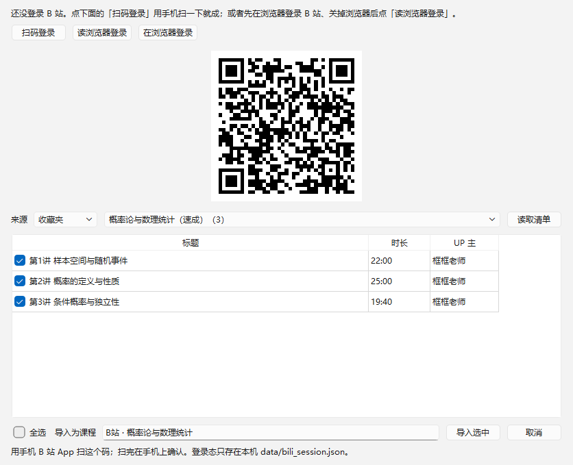

自检：`python tools_probe_bili.py --show`（假传输层，离线跑完登录→清单→导入→落库）。

### 3.26 知识库的另一半：看过的课自动归档

以前知识库只有"用户上传的讲义"，问模型时"课里讲过什么"只能靠临时检索回看点上下文，答完就散。
现在**每节转写完自动归档一份**进 `kb_docs`：

- path 固定成 `session:<sid>`，重跑先删旧的再写新的（幂等，不会越积越多）；
- 内容 = 本节概要（时长/段数/回看点清单）+ 每 60 秒一块的正文 + 每个回看点单独一块；
- 每块都带 `source_ref`（`00:03:20` 这种时间码），检索命中时能把出处喊出来；
- 绑在这门课的 `course_id` 上，所以同一门课里"第 5 讲的问题"能检索到"第 2 讲的原话"。

设置页「把看过的课全部归档」补历史（只归档有音频、有转写、时长 > 0 的节：
空的不能算知识）。归档后 `kb_sig` 自动更新，问模型那边不用手动重建索引。

### 3.27 自动抓取体检：把误触发变成样本

误触发的短抓取被丢掉时（§3.18 的护栏），现在会写一行 `capture_discards`
（触发进程、站点、页面标题、录了多久、当时阈值）。设置页据此显示：

> 最近 30 天丢掉 2 次：中位 11.8 秒、最长 11.8 秒；当前阈值 8 秒。建议调到 13 秒。

「按记录调阈值」把这个建议写进 `capture.web_min_keep_s`（比最长那次再长 1 秒），
「清空记录」从头攒。这样阈值不是拍脑袋的 8 秒，而是**这台机器**上被丢掉的东西有多长说了算。

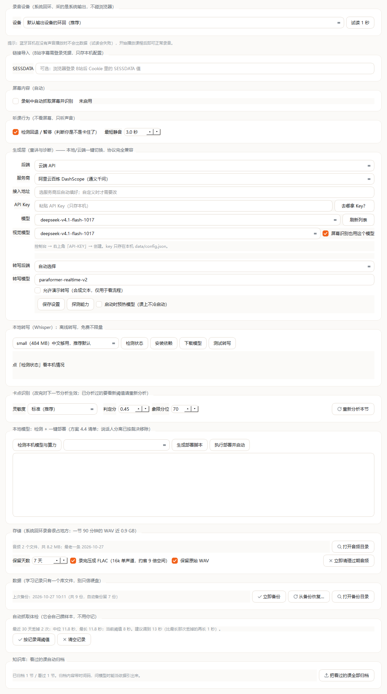

自检：`python tools_probe_settings.py --show`。

## 5. 已实现 / 未实现（对照方案）

| 方案条目 | 状态 |
|---|---|
| 4.2 系统回环采集、按进程分离、渐进增强 | 回环采集**已实测**；按进程分离未做（当前用设备级回环） |
| 4.4 七个模型的分工 | 注册表 + 检测 + 部署脚本已备；本机 8 GB 显存跑不动 122B，属环境限制 |
| 4.3 本地转写 | **已实现并实测**：faster-whisper 依赖/模型/自检都在界面里（见 4.1） |
| 5.1 双遍转写 | 接口与 pass_no 已留，融合对齐未实现（需真实两遍转写数据） |
| 5.2.1 认知负荷五特征 + z-score + sigmoid | **已实现并测试**（含 τ 缩放，见 docs/算法说明.md） |
| 5.2.2 行为信号六类事件 + 衰减 | **已实现**；无播放器事件时用音频指纹推断回退/重复播放 |
| 5.2.3/5.2.4 四象限 + 融合分级 | **已实现** |
| 5.2.5 隐性回看点三机制 | 事后证据：部分（知识点共现）；抽样自测：**未做**；跨课对账：按"同一门课多节"实现 |
| 5.2.6 权重校准 | **已实现**（含负样本策略） |
| 5.2.7 可解释依据 | **已实现**，每个回看点都带人话解释 |
| 5.3 时间轴对齐 | 以播放进度为主轴；词级时间戳表已建，双遍对齐未做 |
| 3.3 五种重讲策略 | **已实现**（无模型时给结构化提纲，不编假答案） |
| 3.4 画面取证（故事板） | **已实现**：回看点处取视频帧 → 视觉模型 → 屏幕证据（见 2.9） |
| 3.4 链接导入（字幕优先） | **已实现**：B站/YouTube 取字幕，无字幕则只下音轨（见 2.8） |
| 3.4 F3 截图对回课程 | **已实现**：算法按画面变化自动抓帧 → 视觉模型识别 → 进同一条时间轴（见 2.6） |
| 3.3+ 对话与知识库 | **已实现**：带回看点上下文的问答 + 自带资料 BM25 检索（见 2.7），回答标注出处，引用带页码/时间码（见 3.7） |
| 3.5 F4 漏洞地图 | **已实现**；知识点掌握度闭环（过了 90% 门槛回看点才熄灭，见 3.6） |
| 3.3+ 回看点小测 | **已实现**：3 道 4 选 1，`evidence` 必须能回查原文，查不到就作废（见 3.8） |
| 3.3+ 待答问题 | **已实现**：听课攒、课后集中答（见 3.9） |
| 3.5+ 覆盖度 | **已实现**：明确写出「几个回看点没有画面证据」（见 3.10） |
| 3.5+ 笔记导出 | **已实现**：装订成 markdown 存到 data/export/（见 3.11） |
| 2.7 检索加固 | **已实现**：查询改写 fail-open + 索引签名过期提示（见 3.12） |
| 2.7+ 复习排程 | **已实现**：稳定度 + 留存 + 该复习排序 + 下一步建议（见 3.13） |
| 5.x 知识点抽取 | **已实现**：元词不再是知识点，术语三层证据 + 模型提名需原文可查（见 3.14） |
| 5.x 硬门槛 | **已实现**：没过 90% 只能重讲，重讲策略由证据决定（见 3.15） |
| 5.2 学习顺序 | **已实现**：知识图谱的边判前置，下一步先补没有未补前置的那个（见 3.16） |
| 4.x 练习导入 | **已实现**：老师发的 xlsx/csv 直接可判分，来源与模型题分开标（见 3.17） |
| 4.2+ 网页视频自动抓 | **已实现**：按浏览器音频会话起停，任何站点、不装插件（见 3.18） |
| 6.x 边看边问 | **已实现**：置顶小窗，截图 Ctrl+V / 文件拖进去就能发（见 3.20） |
| 界面骨架 | **已实现**：左栏导航 + 页头 + 录制卡，低频操作进「更多」菜单；27 个手画图标（见 3.19 / 3.19b） |
| 音频生命周期 | **已实现**：分析完压成 16 kHz FLAC（省 9 倍），到期自动清理，压完仍可重新转写/重分析（见 3.21） |
| 回看 | **已实现**：回看点时间点一键复制，回原播放器拖过去看（不做内嵌播放，见 3.22） |
| 回看点纠错 | **已实现**：确实卡住 / 不算回看点 / 撤销，dismissed 不删数据且重分析不复活（见 3.23） |
| 数据维护 | **已实现**：每日自动备份 + 手动备份/恢复（恢复前留保险）+ 课程节次整理 + 复习提醒 + 时间轴缩放（见 3.24） |

## 6. 自检命令

```bash
.venv\Scripts\python.exe -m pytest tests -q      # 358 个算法/管线/知识库/掌握度/小测/队列/复习/导出/检索/链接/画面/术语/闸门/练习导入/音频/回看点纠错/备份/缩放/提醒测试
.venv\Scripts\python.exe tools_smoke.py          # 回环录音→视频导入→侧车转写→指纹 全链路
.venv\Scripts\python.exe tools_ui_check.py       # 界面离屏渲染 + 像素/字体断言
.venv\Scripts\python.exe tools_probe_audio.py    # 逐个环回设备试读，判断哪个现在能录
.venv\Scripts\python.exe tools_migrate_demo.py --apply   # 术语规则升级后重建演示会话（自动备份库）
.venv\Scripts\python.exe run_app.py --selftest   # 不开界面跑一遍分析
.venv\Scripts\python.exe run_app.py --probe-vision  # 用自造中文测试图探测视觉模型
.venv\Scripts\python.exe run_app.py --probe-webvideo  # 看浏览器音频会话，判断能不能自动抓网页视频
.venv\Scripts\python.exe run_app.py --probe      # 命令行探测模型端点
```

## 7. 目录

```
dsh_app/
  config.py        设置、模型注册表、云端预设
  db.py            SQLite（方案 5.4 的表 + 我补的 4 张表）
  cognitive/       features.py（负荷五特征）、scoring.py（行为/融合/校准）
  asr/             转写四后端（OpenAI兼容 / faster-whisper / 侧车字幕 / 演示）
  llm.py           统一接入层：探测 + 降级
  review.py        五种降维重讲（闸门锁死时由证据强制选一种）
  terms.py         术语抽取：定义句式 + 术语后缀 + 学科词表（模型只提名，代码验真）
  webvideo.py      网页视频自动抓：浏览器音频会话判定 + 起停时序（不装插件）
  bili.py          B 站：读浏览器 cookie（DPAPI+AES-GCM）/ 扫码登录 / 收藏夹·合集·历史
  ui/theme.py      主题：橙白色板 + 全局 QSS（颜色只在这里出现一次）
  ui/chat_html.py  对话气泡：Qt 富文本只认 table bgcolor，所以用表格拼
  ui/chat_window.py 问模型小窗：置顶浮窗 + 拖放/粘贴附件
  ui/icons.py      图标：手写 SVG 现渲，颜色跟着主题走
  ui/assets/       QSS 要用的位图（勾选标记；由 tools_make_check_icon.py 生成）
  attachments.py   附件：图片压成 data URL、文档抽文本、不支持的明确报错
  exercises.py     练习导入：xlsx/csv 解析、模板生成、错误带行号
  audio_io.py      音频读写收口：分块转 FLAC、读段、量时长（WAV/FLAC/导入的 m4a 都认）
  maintenance.py   音频占用/过期清理、sqlite 快照备份与恢复
  capture.py       WASAPI 回环（回调式）、媒体导入、音频指纹、设备试读
  pipeline.py      编排 + 实时分析 + 诊断 + 校准
  local_deploy.py  本地模型检测与一键部署
  ui/bili_dialog.py 从 B 站导入课程：登录、选来源、勾选集数、导入为待录的节
  ui/              PySide6 主窗口与时间轴
docs/算法说明.md   方案里所有"没写清"的算法缺口，我的裁决与理由
docs/screenshots/  四个页签的实际渲染截图
```

数据落在 `data/`（config.json / app.db / audio/ / logs/），全部本机，不上传。
## 8. 从源码跑起来（换一台机器）

```bash
git clone https://github.com/litt1ebubb1es/xiaoxie-study-helper.git
cd xiaoxie-study-helper

py -3.11 -m venv .venv
.venv\Scripts\python.exe -m pip install -U pip
.venv\Scripts\python.exe -m pip install -r requirements.txt

# 第一次跑：复制一份配置模板，然后在界面「设置与模型部署」里填 Key
copy data\config.example.json data\config.json

.venv\Scripts\python.exe run_app.py            # 开界面
.venv\Scripts\python.exe run_app.py --selftest  # 不开界面自检
.venv\Scripts\python.exe -m pytest -q           # 跑测试
```

要求：Windows 10/11（回环录音用 WASAPI，`pyaudiowpatch` 只在 Windows 上有）、Python 3.11+。
不需要系统装 ffmpeg（`imageio-ffmpeg` 自带一份）。

### 配置与密钥
- 仓库里只有 `data/config.example.json`：所有密钥字段都是空字符串，`base_url` 是公开的阿里云百炼兼容端点，抄一份改名就能用。
- 不想用云端就把 `llm.backend` 改成 `local`，在设置页点「检测本机模型与算力」，它按你的显存/内存推荐能跑的规格。
- 如果你 fork 后自己改了配置并想提交，**先确认里面没有 Key**：`git diff --cached` 看一眼再 commit。

### 开源范围

- 代码、图标（`dsh_app/ui/icons.py` 手写 SVG）、`docs/算法说明.md`、`docs/screenshots/`、`docs/ppt/` 都在 MIT 下发布。
- 不随仓库分发：`data/`（运行时数据与密钥）、`docs/video/work`、`docs/video/out`（几百 MB 的逐帧与成片）、
  `docs/video/assets/*.mp3`（背景音乐，替换成你自己有授权的曲子）、`_ref/`（第三方参考资料，版权不属于本项目）。

## 9. 许可

MIT，见 [LICENSE](LICENSE)。商用、改、再发布都行，保留版权声明即可。
欢迎 issue / PR；提 PR 前跑一遍 `pytest -q` 和 `run_app.py --selftest`。
